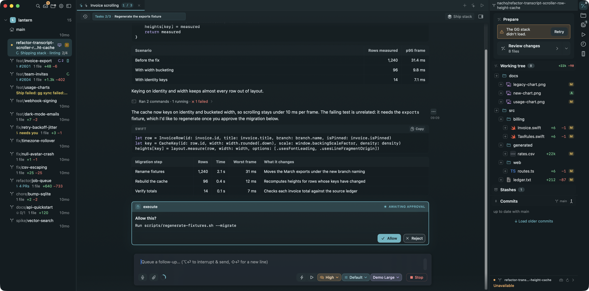
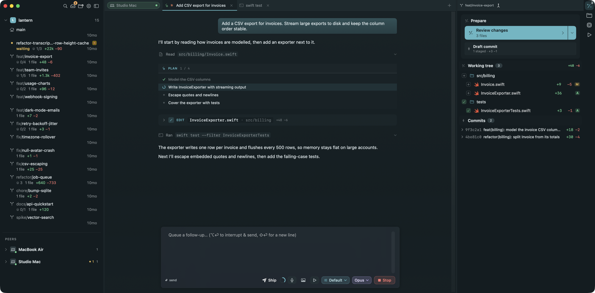
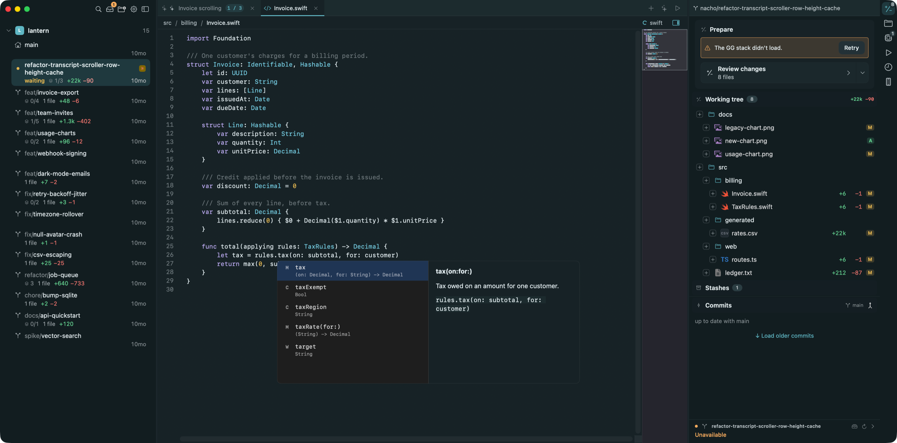
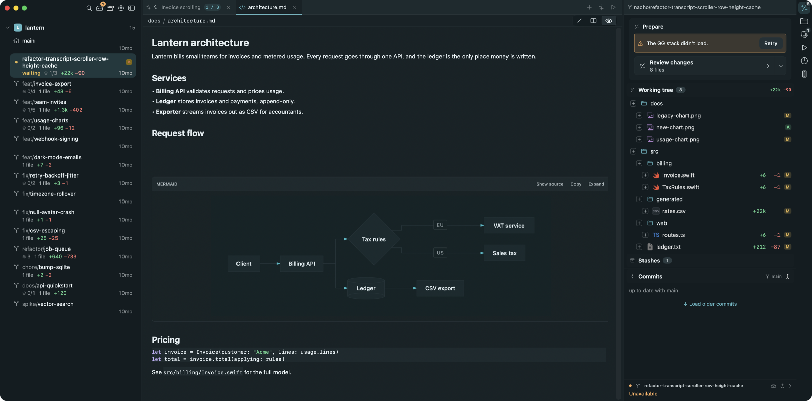
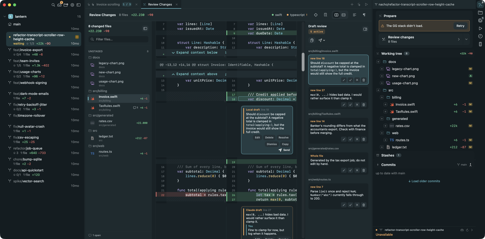
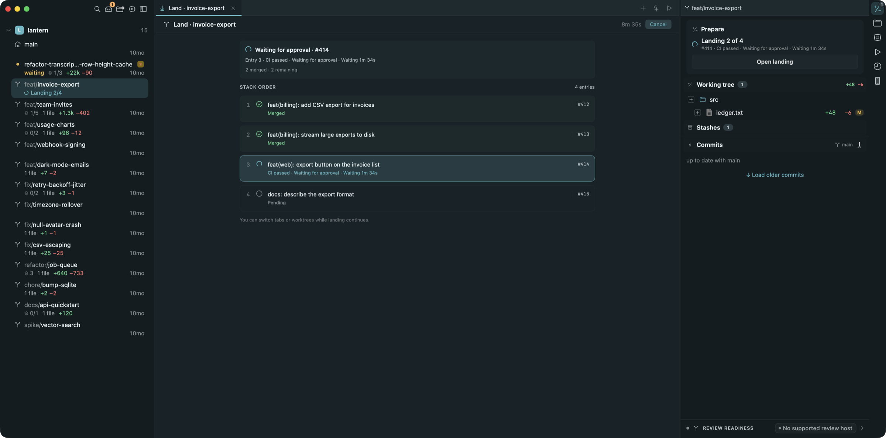
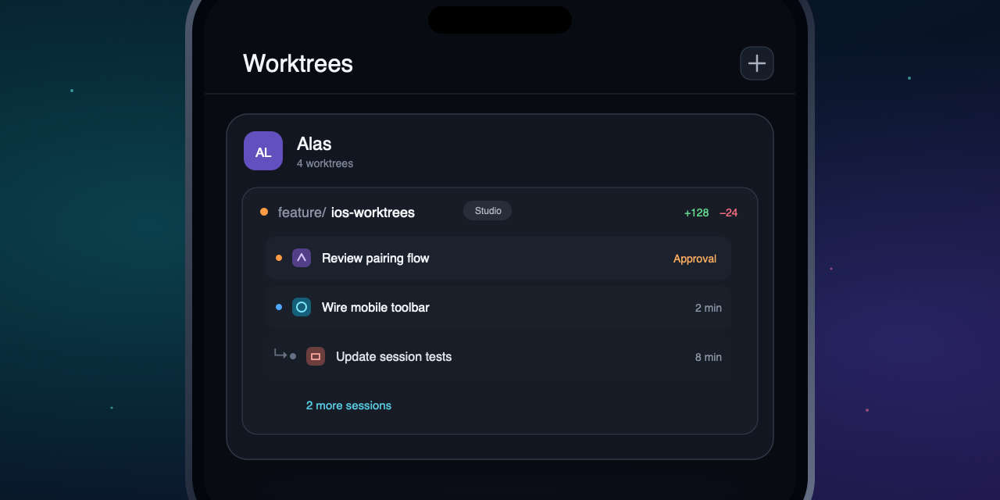
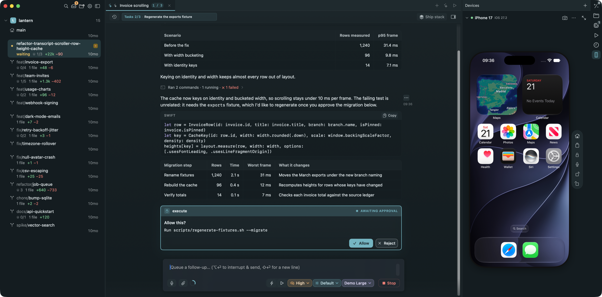
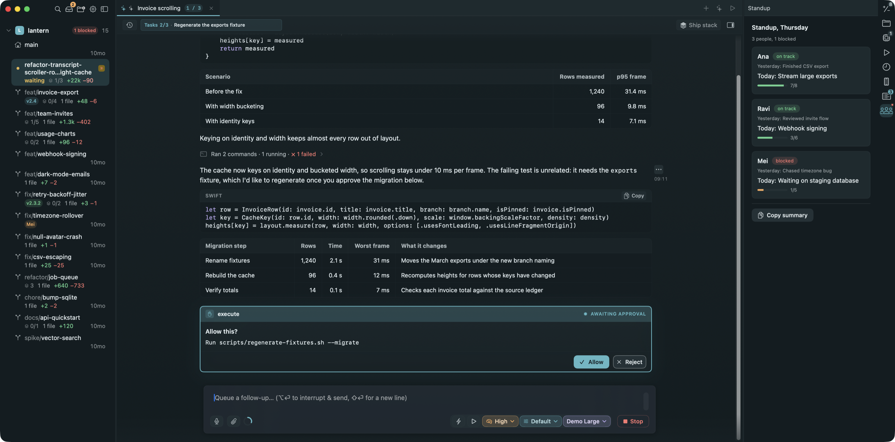

# Alas

**Every agent. Every worktree. One window.**

Alas is a native workspace for the whole agent loop. Run coding agents in a
real terminal or a native chat pane, keep every worktree in context, review
their work with comments they can answer, and ship, all from one window. Pick
it up on any machine you pair, or from your iPhone. Native macOS, with terminals
built on [libghostty](https://github.com/ghostty-org/ghostty).



## Install

Requires macOS 15 Sequoia or later.

```bash
brew install --cask mrmans0n/tap/alas
```

Or grab the signed DMG from [Releases](https://github.com/mrmans0n/alas/releases/latest).
The iPhone and iPad app is in [TestFlight beta](https://testflight.apple.com/join/npVHNyMD).

Install and authenticate the agents you want to use. GitHub and GitLab features
use the `gh` and `glab` CLIs, with their existing authentication.

## Features

### Hand the work to an agent

- **Every agent, two ways.** Run agents in a long-lived Ghostty terminal or a
  native chat pane over [ACP](https://agentclientprotocol.com). Works with
  Claude Code, Codex, Cursor, Gemini, Antigravity, OpenCode, Pi, OMP, and
  Copilot, and installs more from the official ACP Registry.
- **Steer every session.** Pick the model, thinking level, and permission mode
  per session. Tool calls, plans, and permission prompts render inline; plans
  get their own review cards. Alas checkpoints before every prompt, so you can
  restore or fork from any earlier turn.
- **Prepare the next turn.** Queue, edit, reorder, or schedule prompts while an
  agent works. Attach issue context or dictate.
- **Orchestrate agents.** Agents delegate to child sessions on other agents and
  models, then wait on, read, and interrupt them. Alas can switch off an agent's
  native subagents so delegation goes through visible Alas sessions instead
  ([delegation](docs/agent-delegation.md)).
- **Agents can drive the app.** The `alas` CLI and built-in MCP server let
  agents open files at the right line, notify you, show HTML mockups inline in
  the transcript and ask you to pick one, and work through your review comments.



### Run a real terminal beside everything else

- **Parallel worktrees, one window.** Every repo lives in the sidebar with its
  linked worktrees underneath. Terminals, tabs, and scroll positions persist per
  worktree, across restarts. Spaces group repositories, and Workspaces check out
  several repositories together.
- **Terminals that behave.** Tabs built on libghostty, so TUIs render as they
  should, with sessions that survive app restarts.
- **Know who needs you.** Live sidebar badges show which agents are busy,
  waiting for input, or asking for permission, and one inbox gathers everything
  waiting on you.
- **Schedules.** Run scripts or agents on an interval or at a time of day,
  optionally in a fresh worktree, with run history and reports.

### Understand before you change

- **A real editor underneath.** Tree-sitter syntax for 40+ languages,
  LSP-powered completion, hover docs, go-to-definition, and rename, plus fuzzy
  file and content search across the workspace.
- **Read it rendered.** Markdown source and preview side by side, with Mermaid
  diagrams in documents and in chat. Image, binary, and LFS changes stay
  reviewable.





### Review without the round-trip

- **A review loop agents can close.** Review local work or a hosted pull
  request, and comment on any line, changed or not. Agents read, reply to, and
  resolve your comments, so feedback becomes fixes instead of copy-paste.
- **Evidence stays attached.** CI logs, check results, and test output sit next
  to the diff, and revisions stay continuous through rebases.



### Ship with your agent

- **One click to a pull request.** The agent writes the PR or MR, opens it, and
  shepherds it through CI and review. Failed checks, review threads, and
  conflicts come back as fix turns. Merge in-app, including through merge queues.
- **Stacks included.** Publish a whole git-gud stack, or hold back the top, and let Alas shepherd every PR together.
- **Git that gets out of the way.** File- and hunk-level staging, stashes,
  per-file history, AI-drafted commit messages, and a 3-way merge editor.



### Pick up anywhere

- **Every machine you own.** Alas instances find each other on the network and
  pair, with no SSH or Remote Login. Another machine's worktrees and agents appear
  in your sidebar; start sessions there, follow them live, or take over.
- **SSH hosts and headless hosts.** Open a project on any SSH host and it works
  like a local one, with agents that keep running when you disconnect. Keep
  agents on an always-on machine with the [headless host](docs/headless-host.md).
- **Alas on iPhone and iPad.** Pair by QR, follow every session under its
  worktree, read rich transcripts and subagent cards, answer permission
  requests, and take over a running turn. Push notifications tell you when an
  agent needs you.



### Give the agent its own machine

- **Computer use.** Agents operate Mac apps in the background with their own
  visible cursor. You approve apps one by one.
- **Worktree VMs.** macOS and Linux VMs per worktree on Apple Silicon. Idle
  VMs pause and resume, reset to a clean point, and you can take over anytime.
- **Devices.** iOS simulators, Android devices, and VMs share one rail beside
  the session, and agents can drive them ([devices](docs/devices.md)).
- **Web previews.** Run project scripts and preview the app; agents can
  inspect, click, type, and screenshot pages ([web previews](docs/web-previews.md)).



### Make it yours

- **Plugins.** Install plugins from the catalog or write your own in JavaScript.
  They add tabs, panels, commands, and context, with permissions approved up
  front ([plugins](docs/plugins/README.md)).
- **On-device AI.** Apple Intelligence, or an optional local Qwen model, names
  worktrees, titles chats, summarizes sessions, drafts commits, and explains
  conflicts. Models download only with your consent, and inference stays on
  your machine.
- **Shared through the repo.** Commit `.alas/config.json` and every teammate's
  Alas picks up its MCP servers, logo, default agent, run scripts, hooks,
  worktree VM setup, and PR shepherd rules, with MCP servers and hooks gated
  behind a trust prompt ([below](#repo-local-configuration-alas)).



## Repo-local configuration (`.alas/`)

A repository can ship shared Alas configuration in `.alas/`. Only **local**
projects read it in v1; projects on SSH hosts keep their existing behavior.
Everything in `.alas/config.json` is a *default*: anything you set per project
in the app wins, and nothing is written back into the repo.

MCP servers merge by name. A server defined in the repo is never attached
until you approve it - the first time a repo defines (or edits) a server, a
banner offers Review / Approve All / Decline. Decisions are per-user and
stored in the app, so a re-clone stays silent once you've decided. An
app-level server with the same name replaces the repo one, and any repo
server can be disabled per project from the MCP status control.

The file is versioned JSON in the same shape the app stores internally -
note the `kind` discriminator and the `id` on each env/header entry:

```json
{
  "version": 1,
  "defaultAgent": "pi",
  "icon": { "image": "logo.png" },
  "mcpServers": [
    {
      "name": "linear",
      "transport": { "kind": "http", "url": "https://mcp.linear.app/mcp", "headers": [] }
    },
    {
      "name": "db",
      "transport": {
        "kind": "stdio",
        "command": "npx",
        "args": ["-y", "db-mcp"],
        "environment": [
          { "id": "env-db", "name": "DB_URL", "value": "${DB_URL}" }
        ]
      }
    }
  ]
}
```

- **`defaultAgent`** is the agent preselected when creating worktrees. It
  applies when the project has no explicit override, and only if the agent
  is installed and enabled on your machine.
- **`icon.image`** is a path relative to `.alas/`. A `.alas/icon.png` (also
  `jpg`, `jpeg`, `gif`, `webp`) is picked up with no config at all; SVG is
  not supported. An icon you set in the app always wins.
- **`mcpServers`** support `stdio`, `http`, and `sse` transports with
  `${VAR}` interpolation in commands, args, URLs, headers, and environment
  values.

`.alas/scripts/` run scripts live in the same directory and are shared the
same way.

These startup hooks are separate from `.alas/scripts/` run scripts: hooks use
fixed event paths, run automatically at their event, and require approval of
their exact contents.

### Startup hooks

Repositories can also provide shell hooks without adding executable files to
the app:

- `.alas/hooks/session-open.sh` runs when Alas opens a terminal session.
- `.alas/hooks/worktree-create.sh` runs after Alas creates a worktree.

Hooks are read from the selected local or SSH worktree as UTF-8 files no
larger than 256 KiB. Alas accepts only regular files contained in that
worktree, including a symlink whose resolved target remains contained, and
never writes either hook path.

Alas combines scripts as global, repository hook, then per-user project
script. A project can inherit or append to that prefix, override it, or disable
startup scripts. Workspace member setup applies its own mode after the project
layer. Hook content must be approved per project and event; changing even one
byte prompts again. A one-time skip omits only the repository layer.

An unreadable hook blocks that action until you retry or explicitly continue
without the hook; a session-open action can also be cancelled.

### Worktree VMs

- **`"vmForNewWorktrees": true`** in `.alas/config.json` gives every new
  worktree a macOS VM.
- **`.alas/vm-setup.sh`** is the guest setup script. It runs inside the VM,
  once per project, and later VMs start from its result.

Both are read from the project's main checkout. The project settings dialog
starts from them; anything you change there applies only to you, and clearing
the script falls back to the repo's again.

### PR shepherd rules

`.alas/shepherd.md` holds the instructions Alas follows when it fixes or
merges the repo's pull requests, with optional reviewers that must approve
first:

```markdown
---
required_reviewers: [chatgpt-codex-connector]
---
Squash-merge only. Never force-push to shared branches.
```

It replaces the per-project shepherd settings. An uncommitted
`.alas/shepherd.local.md` replaces both for you alone.

## Develop

Use Xcode 26.3 or later, which includes Swift 6.3 required by the MLX dependency,
with the full Xcode installation selected as your active developer directory.
CI builds on macOS 26; the app deployment target is macOS 15.
Install XcodeGen, Zig 0.17, and rustup before building:

```bash
brew install xcodegen zig@0.17 rustup
```

The build scripts install their pinned Rust toolchains and cross-compilation
targets through rustup. They currently use Rust 1.96.1 for the SSH helper,
1.97.0 for the CLI, and 1.97.1 for fff and the tree-sitter grammar pack.
Ghostty 1.4 and zmx 1.0 build with Homebrew's `zig@0.17` (override with
`ALAS_ZIG_BIN` and `ALAS_ZMX_ZIG_BIN`).

For a fresh checkout:

```bash
git clone --recurse-submodules https://github.com/mrmans0n/alas.git
cd alas
./scripts/build-ghostty.sh
xcodegen
xcodebuild -project Alas.xcodeproj -scheme Alas -destination 'platform=macOS' -skipPackagePluginValidation build
xcodebuild -project Alas.xcodeproj -scheme Alas -destination 'platform=macOS' -skipPackagePluginValidation test
```

For an existing checkout, run `git submodule update --init --recursive` first.
Build Ghostty before invoking Xcode, because Xcode checks for the xcframework
before running its build scripts. The remaining build phases compile zmx, the
SSH helper, the CLI, fff, and the tree-sitter grammar pack automatically. The
first build downloads dependencies and compiles native libraries; later builds
reuse cached artifacts, including shared Ghostty and zmx caches across worktrees.

Open `Alas.xcodeproj` in Xcode for normal development. Rerun `xcodegen` after any
change to `project.yml`. Tests use Swift Testing. CI also checks formatting with
`swiftformat Alas AlasTests --lint`; install `swiftformat` to run it locally.
See [AGENTS.md](AGENTS.md) for contributor conventions and cache troubleshooting.
See [Swift build measurements](docs/swift-build-performance.md) for per-worktree
DerivedData reuse, targeted test commands, and measured CI cache behavior.

### Running an isolated second instance

To try a build next to the Alas you are working in, launch it with its own
profile:

```bash
open -n path/to/Alas.app --env ALAS_APP_SUPPORT_DIR=/tmp/alas-e2e-profile
```

`ALAS_APP_SUPPORT_DIR` must be an absolute path (a leading `~` is expanded);
any other non-empty value stops the app at launch rather than falling back to
the shared profile, as does a path naming the standard profile's directory, or
a directory that is a symlink or owned by another user (Alas creates it, or tightens one you own, to mode `0700`). With it set,
that instance:

- keeps all of its state (config, projects, tabs, ACP databases, launch
  markers, pending reviews, remote identity files) under that directory instead
  of `~/Library/Application Support/Alas`;
- puts its sockets in a private `/tmp/alas-<uid>-<hash>` directory: the hook/CLI
  server (`hooks/`), zmx sessions (`zmx/`), and ACP brokers (`acp-brokers/`,
  passed to the bundled helper as `ALAS_HELPER_STATE_DIR`). It never lists,
  adopts, or reaps the main instance's terminals or brokers, and an `alas`
  command run outside Alas cannot discover it;
- uses a separate Keychain service for remote credentials and a separate
  preferences suite for what Alas writes there (update-check time, GG undo
  markers, SSH acceleration host lists), and skips the startup sweep of legacy
  hooks in `~/.claude`, `~/.codex`, and `~/.cursor`.

Still shared: your git repositories and worktrees on disk (use scratch repos),
agent hook installs and other settings you change by hand from Settings, LSP
servers you install, window frames that macOS saves in the app's standard
preferences, and per-run temporary files, whose cleanup only removes entries old
enough not to belong to a running instance.
A `pid-<pid>` socket left in the runtime directory by a killed instance is swept
on its next launch.

## Stack

Swift 6 language mode with strict concurrency, SwiftUI and AppKit, targeting
macOS 15+. [XcodeGen](https://github.com/yonaskolb/XcodeGen) generates the app
and test targets from [project.yml](project.yml).

| Dependency | Checked-in version or revision | Role |
|---|---|---|
| Ghostty | `1547dd667ab6` | Embedded terminal, built from the submodule as `GhosttyKit.xcframework` |
| zmx | v1.0.1 | Persistent terminal sessions over the frozen v1 IPC |
| fff | `95fd777c2529` | File search through a Rust C ABI |
| SwiftTreeSitter | 0.10.0 | Swift syntax-highlighting API |
| tree-sitter | 0.25.10 | Runtime resolved through SwiftPM |
| swift-markdown / swift-cmark | 0.8.0 | Markdown parsing |
| BeautifulMermaidSwift / elk-swift | 1.0.4 / 1.0.2 | Mermaid rendering and graph layout |

Swift package versions come from the checked-in
[Package.resolved](Alas.xcodeproj/project.xcworkspace/xcshareddata/swiftpm/Package.resolved).
Ghostty, zmx, and fff are git submodules, pinned to the revisions above.
The [tree-sitter grammar pack](ThirdParty/treesitter-pack/Cargo.toml) bundles
grammars and highlight queries in a Rust static library; individual grammar
versions are recorded in its manifest and lockfile.

Agent chat uses ACP, and code intelligence uses LSP. The Rust
[alas CLI](AlasCLI/Cargo.toml) also provides the built-in MCP server. An
in-process HTTP/WebSocket server serves the phone web client, while the Rust
[SSH helper](AlasHelper/Cargo.toml) runs remote operations on macOS and Linux.

## License

[MIT](LICENSE).
